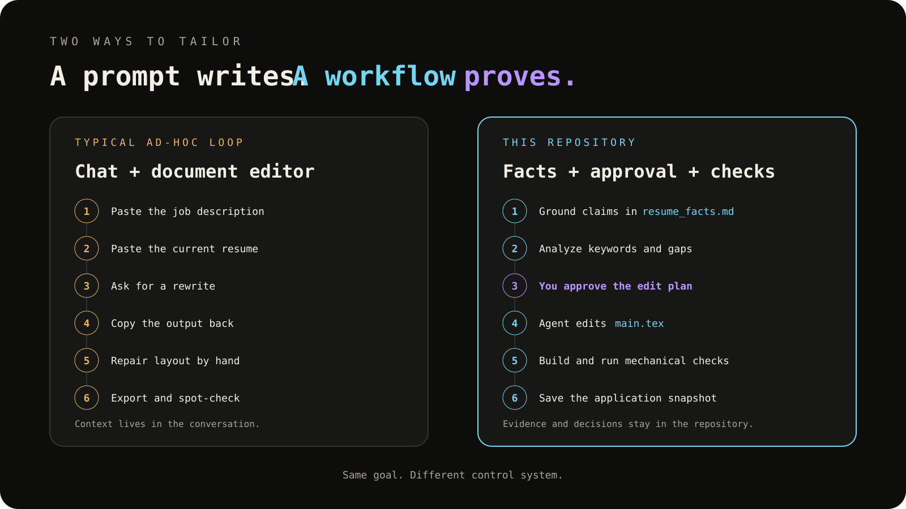
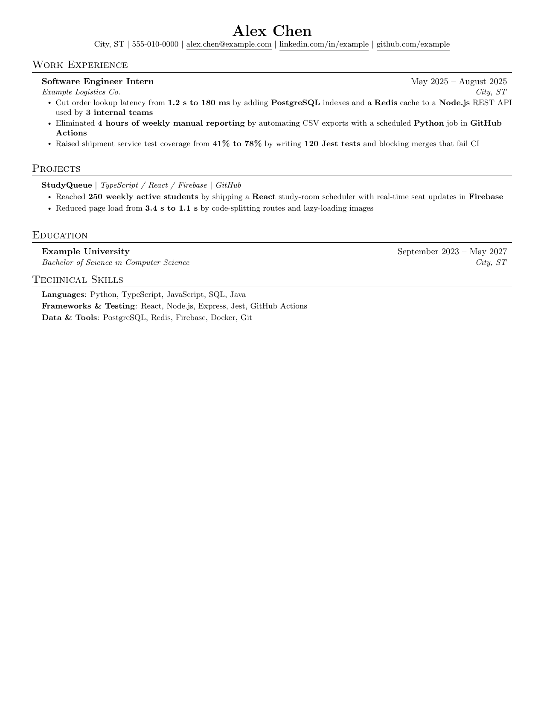
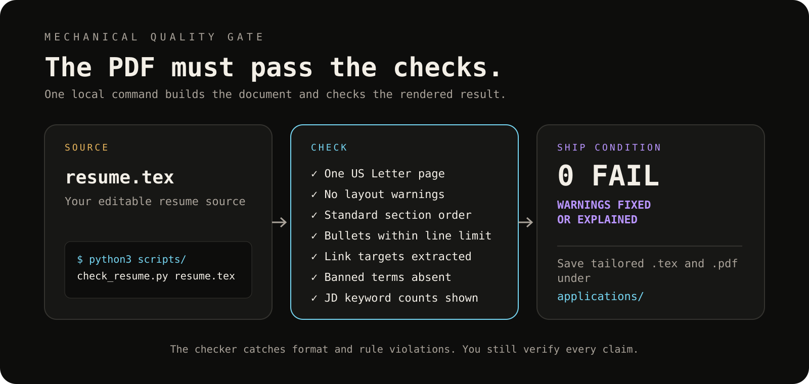

<div align="center">

# resume-tailor

**An AI resume-tailoring workflow that refuses to lie.**

Clone it, bring your own coding agent, tailor your resume to any job description in
minutes — with every claim traceable to a fact you can defend in an interview.

[](LICENSE)
[](AGENTS.md)
[](#compatible-agents)


</div>

---

## Why this exists

Most "AI resume" tools optimize for one thing: getting past the keyword filter. They'll
cheerfully stuff in a technology you've never touched if a job posting mentions it enough
times. That gets you an interview you can't survive.

This repo does the opposite. It's a set of agent instructions (`AGENTS.md`) plus a Python
checker script that make fabrication *structurally harder than honesty*:

- Every claim on the resume must trace back to a fact in `profile/facts.md`, tagged
  `verified`, `confirmed`, or `estimate` — no fact, no claim.
- A `profile/never_claim.md` blocklist makes certain technologies physically impossible
  to add, even when a job description demands them and the agent would "helpfully" try.
- The agent is **forced to stop and show you its plan** before it rewrites a single
  bullet — no silently rewriting your resume while you're not looking.
- A **Python checker + git hook** re-verifies the PDF after every change: page count, no
  em dashes, ATS reading order, every never-claim term, keyword placement in the
  recruiter eye-tracking "hot zone." The agent cannot claim "done" if the script says
  otherwise.

A chat keeps context in the conversation. This template keeps evidence and decisions in
files you can inspect, diff, and reuse. It does not guarantee a job or an ATS score; it
gives the tailoring process a source of truth and a quality gate.

<p align="center">
  
</p>

<div align="center">


<sub>The fictional sample this repo ships with — rendered from <code>template/resume.tex</code>, checked at 0 FAIL / 0 WARN</sub>
</div>

## How it works

Run `/setup` once to build `profile/facts.md` (tagged `verified` / `confirmed` /
`estimate`) and `profile/never_claim.md` (blocked technologies). Then for every job
description, run `/tailor` and the agent works through six steps: keyword extraction,
ATS match & gap analysis (stop here for your approval), impact-bullet rewrite, ATS +
recruiter pass, final keyword polish, and verify & build. The last step runs
`scripts/check_resume.py` against `resume.tex` — 0 FAIL produces `resume.pdf`; any FAIL
sends the agent back to rewrite.

<p align="center">
  
</p>

The checker isn't advisory — it's wired into a **Claude Code `Stop` hook**
(`.claude/settings.json`). Whenever `resume.tex` changes, the agent's turn is blocked
until the script reports zero failures. Other agents (Codex, Cursor, Gemini CLI) follow
the same rule because it's written into `AGENTS.md` as a required step, but only Claude
Code enforces it mechanically today.

## Quickstart

```bash
git clone https://github.com/Bruce1508/resume-tailor.git my-resume
cd my-resume
```

Open the folder in your coding agent of choice (`claude`, `codex`, `cursor`, `gemini`, …)
and run:

```
/setup
```

The agent interviews you job-by-job and project-by-project, builds `profile/facts.md`
and `profile/never_claim.md`, and writes your first `resume.tex` from the included
LaTeX template. Then, for every job you apply to:

```
/tailor
<paste the job description>
```

The agent stops after Step 2 (the match score and gap analysis) and waits for your
go-ahead before touching a single bullet.

### Prerequisites

| Tool | Why | Install |
|---|---|---|
| A LaTeX distribution (`latexmk`) | Builds `resume.tex` → PDF | [TeX Live](https://tug.org/texlive/) / [MacTeX](https://tug.org/mactex/) / [Tectonic](https://tectonic-typesetting.github.io/) |
| `poppler-utils` (`pdftotext`, `pdfinfo`) | The checker reads the built PDF | `brew install poppler` / `apt install poppler-utils` |
| Python 3.9+ | Runs `scripts/check_resume.py` | standard library only, no pip install needed |
| A coding agent | Runs the workflow | Claude Code, Codex CLI, Cursor, Gemini CLI, … |

No LaTeX locally? Paste `resume.tex` into [Overleaf](https://www.overleaf.com/) instead —
you'll lose the automated checker, so run it on your own machine before submitting.

## Repository layout

| Path | Tracked in git? | Purpose |
|---|---|---|
| `AGENTS.md` | ✅ | The whole workflow — the only file that matters for behavior |
| `CLAUDE.md`, `.gemini/settings.json` | ✅ | One-line pointers so every agent reads `AGENTS.md` |
| `.claude/commands/{setup,tailor}.md` | ✅ | `/setup` and `/tailor` slash commands for Claude Code |
| `.claude/settings.json` | ✅ | The `Stop` hook that enforces the checker |
| `scripts/check_resume.py` | ✅ | Standalone PDF/LaTeX auditor, zero dependencies |
| `template/resume.tex` | ✅ | Jake-style LaTeX resume with fictional sample content |
| `profile.example/` | ✅ | Example `facts.md` / `never_claim.md` to copy from |
| `profile/` (yours) | ❌ gitignored | Your real facts — never leaves your machine unless you remove it from `.gitignore` |
| `resume.tex`, `resume.pdf` | ❌ gitignored | Your real resume |
| `applications/` | ❌ gitignored | Per-company tailored snapshots |

> **Your facts never touch this repo's history.** If you fork this as a *public* repo for
> your own use, review `.gitignore` before committing — it's set up to keep `profile/`
> and your built resume local by default.

## What the checker actually catches

`python3 scripts/check_resume.py resume.tex` builds the PDF and fails loudly on:

- Page count ≠ 1 or wrong page size
- Any `Overfull`/`Underfull` LaTeX warning
- Em dashes in the rendered text
- A bullet that renders on 3+ lines
- A banned section heading (Summary / Profile / Objective / About)
- Section order out of sequence
- A `profile/never_claim.md` term anywhere in the resume
- A "Skills-line-only" term appearing inside a bullet
- A buzzword (`synergy`, `passionate`, `team player`, …)
- Missing `mailto:` link

…and warns (fix-or-justify) on:

- A bullet with no number in it
- A result metric landing past word 7 (recruiter eye-tracking F-pattern)
- A repeated word inside one bullet
- Multiple bullets opening with the same verb
- Mixed date formats
- A top-5 job-description keyword missing, or buried past the first 100 words

## Compatible agents

Any agent that reads [`AGENTS.md`](https://agents.md) works out of the box:

- **Claude Code** — full support: `/setup`, `/tailor`, and the enforced `Stop` hook
- **Codex CLI**, **Cursor**, **opencode** — read `AGENTS.md` natively
- **Gemini CLI** — reads `AGENTS.md` via the `.gemini/settings.json` pointer included here

## FAQ

**Can I use this for a non-software role?**
The bullet-writing and ATS rules are stack-agnostic, but `AGENTS.md`'s examples and the
heat-map/keyword mechanics were built against SWE job postings. Expect to edit the
wording, not the mechanism.

**What if I don't have a metric for something real I did?**
`AGENTS.md` Section 5.2 has the answer: don't invent a number, change what the bullet
*asserts* until the true claim becomes quantifiable.

**Does this send my data anywhere?**
No network calls. Everything — your facts, your resume, the checker — runs locally
through whatever coding agent you point at this folder.

## Credits

LaTeX base template adapted from [sb2nov/resume](https://github.com/sb2nov/resume) via
Jake Gutierrez's well-known fork. The tailoring methodology and checker script are
original to this repo.

## License

[MIT](LICENSE)
